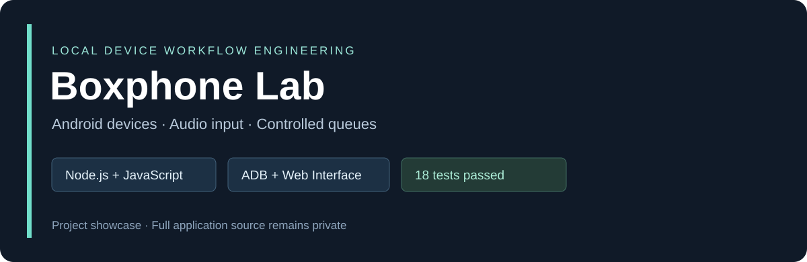
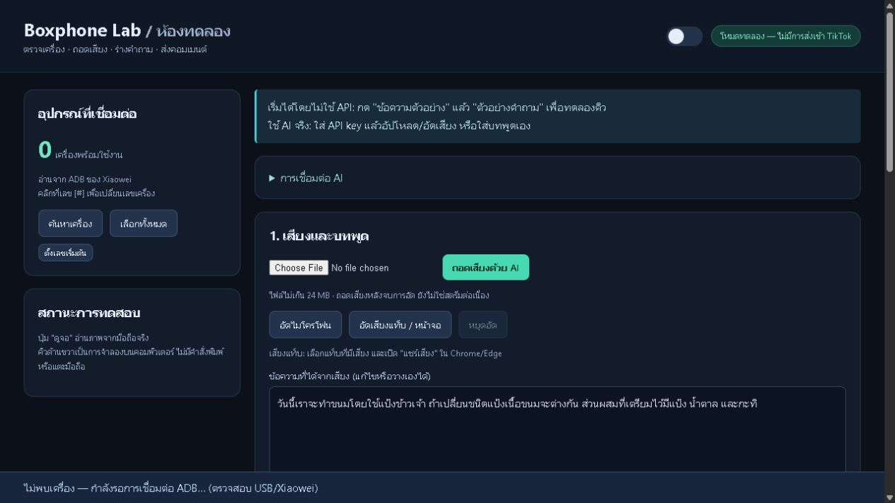
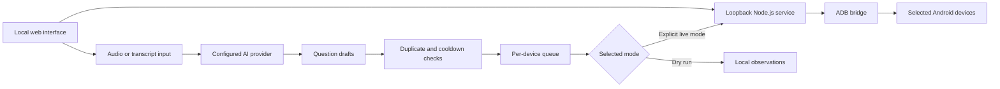

# Boxphone Lab — Local Device Workflow Portfolio

**A Windows-local web application for coordinating Android-device workflows, speech-to-text input, AI-assisted question drafts, and controlled message queues.**

ผลงานโปรแกรมควบคุมงานมือถือผ่านเว็บบนเครื่อง Windows เชื่อมต่อ ADB รองรับการจัดคิว ข้อความแยกเครื่อง การถอดเสียง และการร่างคำถามด้วย AI พร้อมโหมดทดลองก่อนส่งจริง

This public repository is a case study for job applications. Full application source and implementation details are maintained in a separate private repository. This standalone project is distinct from the later Boxphone integration in Live Hub.

## Technology

| Area | Implementation |
| --- | --- |
| Local backend | Node.js, built-in HTTP server, JavaScript ES modules |
| Interface | HTML, CSS, vanilla JavaScript |
| Device bridge | Android Debug Bridge and Xiaowei integration |
| Text input | Optional ADBKeyBoard integration |
| AI adapters | Speech transcription and structured question generation; OpenAI/OpenRouter configuration |
| Validation | Node.js built-in test runner and JavaScript syntax checks |
| Launch workflow | Windows command and PowerShell launchers |

## Application preview

This is the supplied application running in **dry-run mode with an empty-device test fixture**. It demonstrates the interface without revealing device serials, account details, API keys, or recorded content. It is not evidence of a live hardware or message-delivery test.

## Main workflows

- Discover and select devices through a local ADB bridge.
- Inspect a selected device and configure per-device input coordinates.
- Accept a transcript or captured audio as input to a question-drafting workflow.
- Assign drafts to individual devices and manage a delivery queue.
- Separate dry-run queue processing from explicitly confirmed live mode.
- Stop continuous work and discard late or stale results.
- Export queue results for inspection.

## Engineering decisions

### Local access boundary

The service binds to the loopback interface and checks the request host, origin, and a per-session request token. Device operations pass through the local service instead of exposing ADB directly to the browser.

### Cancellation and stale asynchronous results

Question generation and segmented audio processing can outlive the user's current action. Tests check that a stopped operation or a changed transcript cannot enqueue a late result as though it were current.

### Queue policy across devices

The implementation distinguishes message similarity, per-device assignment, and global/per-device cooldowns. These are software controls; they do not guarantee acceptance by an external application.

### Conservative delivery observations

Completing an ADB command or clearing a text field is not treated as proof that a remote service accepted a message. Tests distinguish focused editors, identifiable send controls, stale comments, and newly observed local UI content.

## Verification

Checked on **2 November 2026**, using **Node.js 24.20.0 on Windows**:

- **18 automated tests passed**, with 0 failures and 0 skipped tests.
- Server and browser application JavaScript passed syntax checks.
- Archived source files were compared byte for byte with the supplied folder.
- The public repository contains only this case study and presentation assets.

Automated checks use simulated devices, UI nodes, audio events, and AI responses. Paid AI services, microphone/tab permissions, physical-device actions, and real message delivery were not tested during portfolio preparation.

## Source access

Application source, tests, launchers, and executable dependencies remain in a **private repository**. A guided walkthrough or a controlled demonstration can be arranged during an interview; source access requires the owner's approval.

Related work:

- [Live Hub full-stack application](https://github.com/notza0816581058/Tiktok-rerun-portfolio)
- [n8n automation workflows](https://github.com/notza0816581058/n8n-workflows-portfolio)

Project profile: [notza0816581058](https://github.com/notza0816581058).

This is an independent project, not an official TikTok, Android, or Xiaowei product. Development and iteration used AI-assisted tooling; this case study describes implemented behavior and the verification scope above.
